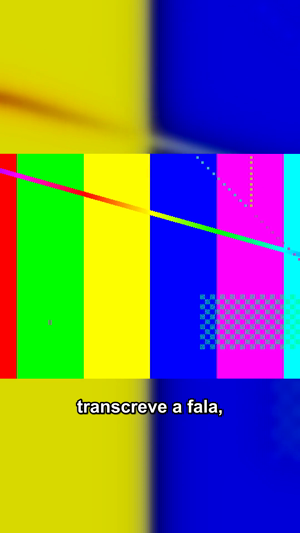
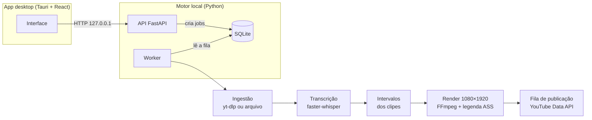

# SignalCut

**Português** · [English](docs/README.en.md)

Aplicativo desktop que transforma vídeos escolhidos pelo usuário em clipes verticais 9:16 com legenda, prontos para YouTube Shorts. Importa por URL ou arquivo local, transcreve a fala no próprio computador, corta, renderiza e, se configurado, publica os clipes por uma fila com recibos.

<p align="center">

</p>
<p align="center"><sub>Quadro de um render real, gerado a partir de um vídeo de teste com fala sintética.</sub></p>

> **Estado:** em desenvolvimento, uso pessoal. O pipeline completo funciona localmente e tem testes automatizados. A publicação no YouTube depende de credenciais OAuth do próprio usuário e não tem verificação automatizada contra a API real (detalhes em [Limitações](#limitações)).

## Como funciona



O app desktop inicia o motor local sozinho: aplica as migrations, sobe a API, espera o `/health` responder e só então inicia o worker. Ao fechar a janela, encerra os dois. Se já houver um backend do SignalCut na porta, ele é reaproveitado; um serviço desconhecido na porta gera erro em vez de ser encerrado.

| Etapa | O que acontece |
| --- | --- |
| Ingestão | URL validada e baixada com yt-dlp, ou arquivo local copiado para o armazenamento interno. O FFprobe lê duração e dimensões. O original nunca é alterado. |
| Transcrição | O vídeo inteiro é transcrito uma vez, com timestamps por palavra. O modelo é carregado sob demanda e reaproveitado entre jobs. |
| Clipes | O vídeo é dividido em trechos sequenciais de duração configurável (30 a 180 s; padrão 90 s). Não há seleção automática de "melhores momentos". |
| Legendas | A transcrição é recortada para cada clipe e agrupada em blocos curtos. Todo texto é escapado antes de virar ASS. |
| Render | Um único encode por clipe: recorte, fundo desfocado, primeiro plano em 4:3 e legenda queimada. Saída H.264/AAC 1080×1920. |
| Publicação | Opcional. Login Google OAuth (app desktop), verificação do canal, conferência do arquivo como Short válido e fila durável que evita envio duplicado após falhas. |

Jobs são encadeados na mesma transação que conclui a etapa anterior, então não existe estado com uma etapa concluída e a próxima esquecida. Erros da API seguem um envelope único com `request_id`, que também aparece nos logs.

## Tecnologias

| Camada | Uso |
| --- | --- |
| Python 3.12, FastAPI, Pydantic | API local e contratos de entrada e saída |
| SQLAlchemy 2, Alembic, SQLite | Persistência e migrations versionadas |
| faster-whisper | Transcrição local com timestamps por palavra |
| yt-dlp, FFmpeg / FFprobe | Ingestão, inspeção de mídia, corte e render |
| Google API Client, OAuth | Publicação opcional no YouTube |
| Tauri 2 (Rust), React 18, TypeScript, Vite | App desktop e gerenciamento do motor local |
| pytest, Vitest, ruff, mypy `strict`, ESLint | Testes e qualidade |

## Estrutura

```
backend/app/
  api/routes/      rotas HTTP: vídeos, clipes, YouTube, health
  core/            configuração, logging, erros e middleware
  models/          modelos SQLAlchemy
  repositories/    acesso a dados (somente flush; commit fica com quem abriu a sessão)
  schemas/         contratos Pydantic
  services/        ingestão, transcrição, clipes, legendas, render, mídia, YouTube
  jobs/, worker.py fila de jobs e worker
  cli/             comandos de operação e diagnóstico
backend/alembic/   migrations
frontend/src/      interface React: componentes, hooks, cliente da API, publicação
frontend/src-tauri/ shell nativo em Rust: janela, CSP, inicialização do motor
tests/             testes do backend
scripts/           desenvolvimento, build Windows e smoke tests
```

A [referência técnica](docs/technical-reference.md) descreve a API, o worker, cada etapa de mídia e as decisões de arquitetura. A [organização de pastas](docs/repository-layout.md) lista onde fica cada parte.

## Executar

### Requisitos

| Requisito | Para quê |
| --- | --- |
| Python 3.12+ | Motor local |
| FFmpeg e FFprobe no `PATH` | Inspeção, corte e render. O `/health` informa se faltarem. |
| Node.js 20+ | Interface |
| Rust stable (MSVC no Windows) e Visual Studio Build Tools | Somente para o app desktop Tauri |
| Microsoft Edge WebView2 | Já vem no Windows 11 |

### Preparação

```bash
python -m venv .venv
.venv/bin/pip install -e ".[dev]"     # Windows: .venv\Scripts\pip install -e ".[dev]"
cp .env.example .env
cd frontend && npm ci && cp .env.example .env
```

### App desktop

```bash
cd frontend
npm run tauri dev
```

No Windows, `.\scripts\dev-desktop.ps1` faz o mesmo em processos separados (`-NoDesktop` sobe só o backend). `scripts/build-windows.ps1` gera `SignalCut.exe`, que depende da pasta do projeto, da `.venv` e do FFmpeg: não é um instalador independente.

### Só o motor local

Na raiz do repositório, porque `STORAGE_ROOT` e `DATABASE_URL` são relativos ao diretório de trabalho:

```bash
alembic upgrade head
uvicorn app.main:app --app-dir backend --port 8000   # API e documentação em /docs
python -m app.worker                                 # em outro terminal
```

Para usar a interface no navegador em vez do Tauri, rode `npm run dev` em `frontend/`.

### Publicação no YouTube

Exige um projeto no Google Cloud com a YouTube Data API v3 ativada e um cliente OAuth do tipo *Desktop app*. O passo a passo, os limites de projetos não auditados e a recuperação de envios interrompidos estão no [guia de publicação](docs/youtube-publishing.md). Credenciais, token e fila ficam em `storage/`, que não é versionado.

## Testes e verificação

```bash
pytest                       # backend
ruff check backend tests
mypy backend tests           # modo strict
cd frontend && npm test && npm run typecheck && npm run lint
```

Resultado em um clone limpo, em 10/11/2026 (Windows 11, Python 3.12.10, Node 24.19):

| Verificação | Resultado |
| --- | --- |
| pytest | 584 testes aprovados |
| ruff / mypy strict | sem problemas em 128 arquivos |
| Vitest | 121 testes aprovados; typecheck e ESLint sem erros |
| `scripts/smoke_whisper.py` com modelo `tiny` real | aprovado |
| Pipeline manual pela API e worker com um MP4 de 57 s com fala sintética | 1 clipe 1080×1920 com áudio e legenda em ~11 s; transcrição em português com alguns erros, como “Signal Cote” no lugar de SignalCut |

A instalação limpa revelou uma incompatibilidade: o PyAV 19 removeu um argumento usado pelo `faster-whisper` 1.2.1, e a transcrição falhava. O `pyproject.toml` agora limita `av<19`.

## Limitações

- **Clipes por duração fixa.** O SignalCut não escolhe os trechos mais interessantes: divide o vídeo em sequência.
- **Publicação sem teste automatizado contra o YouTube.** A fila, a validação de Shorts e o login são testados com dublês. O Google pode manter uploads de projetos não auditados como privados.
- **Desktop focado em Windows.** O motor Python roda em outros sistemas, mas o app empacotado e os scripts foram feitos para Windows.
- **Direitos de uso.** Baixar vídeos de terceiros depende de autorização. O app não contorna restrições de plataformas.
