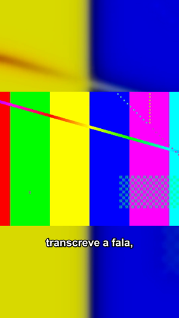
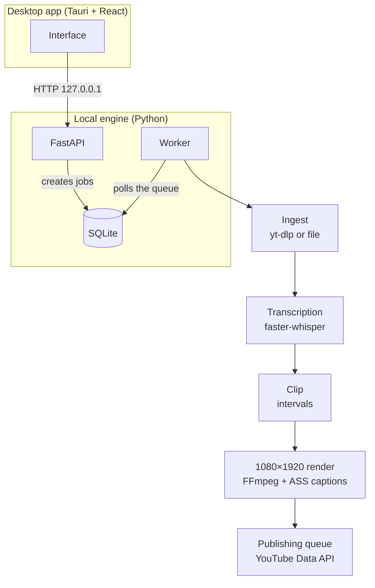

# SignalCut

[Português](../README.md) · **English**

A desktop app that turns videos you choose into captioned 9:16 clips for YouTube Shorts. It imports from a URL or a local file, transcribes speech on your own machine, cuts and renders the clips and, when configured, publishes them through a queue that keeps upload receipts.

<p align="center">

</p>
<p align="center"><sub>Frame from a real render of a test video with synthetic speech.</sub></p>

> **Status:** in development, for personal use. The full pipeline runs locally and is covered by automated tests. YouTube publishing needs your own OAuth credentials and has no automated check against the real API (see [Limitations](#limitations)).

## How it works



The desktop app starts the local engine by itself: it runs the migrations, starts the API, waits for `/health` and only then launches the worker. Closing the window stops both. If a SignalCut backend is already listening on the port, the app reuses it; an unknown service on that port is reported as an error instead of being killed.

| Stage | What happens |
| --- | --- |
| Ingest | A URL is validated and downloaded with yt-dlp, or a local file is copied into internal storage. FFprobe reads duration and dimensions. The original is never modified. |
| Transcription | The whole video is transcribed once, with word-level timestamps. The model loads on first use and is reused across jobs. |
| Clips | The video is split into consecutive segments of configurable length (30–180 s, 90 s by default). There is no automatic "best moments" selection. |
| Captions | The transcript is sliced per clip and grouped into short blocks. All text is escaped before it becomes ASS markup. |
| Render | One encode per clip: trim, blurred background, 4:3 foreground and burned-in captions. Output is H.264/AAC at 1080×1920. |
| Publishing | Optional. Google OAuth for desktop apps, channel verification, a check that the file is a valid Short, and a durable queue that avoids duplicate uploads after failures. |

Each job is enqueued in the same transaction that completes the previous stage, so a finished stage can never leave the next one unscheduled. API errors share a single envelope with a `request_id` that also appears in the logs.

## Stack

| Layer | Used for |
| --- | --- |
| Python 3.12, FastAPI, Pydantic | Local API and request/response contracts |
| SQLAlchemy 2, Alembic, SQLite | Persistence and versioned migrations |
| faster-whisper | Local transcription with word timestamps |
| yt-dlp, FFmpeg / FFprobe | Ingest, media inspection, trimming and rendering |
| Google API Client, OAuth | Optional YouTube publishing |
| Tauri 2 (Rust), React 18, TypeScript, Vite | Desktop app and local engine lifecycle |
| pytest, Vitest, ruff, mypy `strict`, ESLint | Tests and code quality |

## Running it

**Requirements:** Python 3.12+, FFmpeg and FFprobe on `PATH`, Node.js 20+. The Tauri desktop shell also needs stable Rust (MSVC toolchain on Windows), Visual Studio Build Tools and WebView2.

```bash
python -m venv .venv
.venv/bin/pip install -e ".[dev]"     # Windows: .venv\Scripts\pip install -e ".[dev]"
cp .env.example .env
cd frontend && npm ci && cp .env.example .env
npm run tauri dev                     # desktop app, starts the engine itself
```

To run only the engine, from the repository root:

```bash
alembic upgrade head
uvicorn app.main:app --app-dir backend --port 8000   # interactive docs at /docs
python -m app.worker                                 # in a second terminal
```

The [technical reference](technical-reference.md) (Portuguese) covers the API, the worker and every media stage. The [publishing guide](youtube-publishing.md) (Portuguese) explains the Google Cloud setup and how interrupted uploads are recovered.

## Tests and verification

Results from a clean clone on 10 Nov 2026 (Windows 11, Python 3.12.10, Node 24.19):

| Check | Result |
| --- | --- |
| pytest | 584 tests passed |
| ruff / mypy strict | no issues in 128 files |
| Vitest | 121 tests passed; typecheck and ESLint clean |
| `scripts/smoke_whisper.py` with the real `tiny` model | passed |
| Manual run through the API and worker with a 57 s MP4 of synthetic Portuguese speech | one 1080×1920 clip with audio and captions in about 11 s; a few transcription errors, such as “Signal Cote” for SignalCut |

The clean install exposed an incompatibility: PyAV 19 dropped an argument that `faster-whisper` 1.2.1 passes, which broke transcription. `pyproject.toml` now pins `av<19`.

## Limitations

- **Fixed-length clips.** SignalCut does not pick the most interesting moments; it splits the video in order.
- **No automated test against YouTube.** The queue, Shorts validation and login are tested with test doubles. Google may keep uploads from unaudited projects private.
- **Windows-first desktop build.** The Python engine runs elsewhere, but the packaged app and helper scripts target Windows.
- **Usage rights.** Downloading third-party videos requires permission. The app does not bypass platform restrictions.
